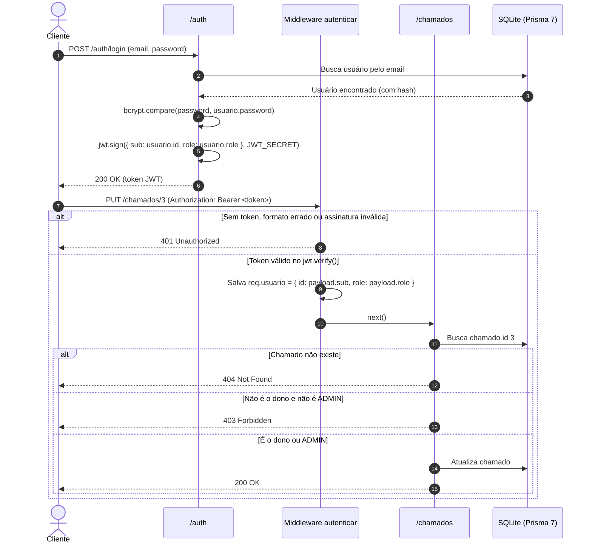

# API Chamados de Suporte - Projeto API Segura

**Grupo:** João Paulo Lourencinho Milho, Matheus Lima Santos, Alyffer Santos Moleiro · 3º AI · ETECAMP

## 1. Sobre o projeto

Esta API gerencia **Chamados de Suporte Técnico** para abertura e acompanhamento de problemas de informática (computadores, rede e equipamentos de sala). Os usuários comuns (`USER`) podem abrir chamados e visualizar, editar ou excluir apenas os seus próprios registros, enquanto os técnicos (`ADMIN`) enxergam todos os chamados abertos, adicionam respostas técnicas, fecham os atendimentos e gerenciam os usuários do sistema. O recurso principal é o modelo `Chamado`, ligado ao modelo `User` por um relacionamento `1:N` (`usuarioId`).

## 2. Como rodar

No terminal, dentro da pasta do projeto, rode os comandos abaixo na ordem:

```bash
npm install
copy .env.example .env        # (No Linux/Mac ou Git Bash: cp .env.example .env)
npx prisma migrate dev --name init
npx prisma generate
npx prisma db seed
npm run dev
```

Depois que o servidor subir, a API e a tela de login simples em HTML + `fetch` estarão disponíveis em `http://localhost:3000`.

Usuários de teste criados pelo `seed` (senha de todos: **`123456`**):

| E-mail | Perfil | Nome |
|---|---|---|
| `admin@chamados.com` | `ADMIN` | Carlos Técnico (Admin) |
| `ana@chamados.com` | `USER` | Ana Souza |
| `bruno@chamados.com` | `USER` | Bruno Oliveira |

## 3. Mapa de rotas

| Método | Rota | Acesso | Proteção |
|---|---|---|---|
| `GET` | `/` | Pública | Serve a tela inicial (`public/index.html`) |
| `GET` | `/api/status` | Pública | — (Status da API em JSON) |
| `POST` | `/auth/register` | Pública | Valida dados e gera hash `bcryptjs` (nasce `USER`) |
| `POST` | `/auth/login` | Pública | Confere senha e devolve o token JWT |
| `GET` | `/auth/me` | Logado | Middleware `autenticar` |
| `PATCH` | `/auth/senha` | Logado | Middleware `autenticar` + confere `senhaAtual` |
| `GET` | `/chamados` | Logado | Middleware `autenticar` (`USER` vê os seus; `ADMIN` vê todos) |
| `GET` | `/chamados/:id` | Dono ou `ADMIN` | Middleware `autenticar` + regra do dono (`404` antes de `403`) |
| `POST` | `/chamados` | Logado | Middleware `autenticar` (`usuarioId = req.usuario.id`) |
| `PUT` | `/chamados/:id` | Dono ou `ADMIN` | Middleware `autenticar` + regra do dono (`404` antes de `403`) |
| `DELETE` | `/chamados/:id` | Dono ou `ADMIN` | Middleware `autenticar` + regra do dono (`404` antes de `403`) |
| `GET` | `/users` | `ADMIN` | Middlewares `autenticar` + `autorizar('ADMIN')` |
| `PATCH` | `/users/:id/role` | `ADMIN` | Middlewares `autenticar` + `autorizar('ADMIN')` |

## 4. Matriz de permissões

| Ação | Visitante | `USER` | `ADMIN` |
|---|---|---|---|
| Cadastrar (`POST /auth/register`) | `201` | `201` | `201` |
| Login (`POST /auth/login`) | `200` | `200` | `200` |
| Ver dados do token (`GET /auth/me`) | `401` | `200` | `200` |
| Listar chamados (`GET /chamados`) | `401` | `200` (só os próprios) | `200` (todos) |
| Criar chamado (`POST /chamados`) | `401` | `201` | `201` |
| Editar/remover próprio chamado (`PUT`/`DELETE /chamados/:id`) | `401` | `200` | `200` |
| Editar/remover chamado de outro usuário (`PUT`/`DELETE /chamados/:id`) | `401` | `403` | `200` |
| Listar usuários (`GET /users`) | `401` | `403` | `200` |
| Mudar perfil de usuário (`PATCH /users/:id/role`) | `401` | `403` | `200` |

## 5. Como funciona a autenticação



- **Cadastro (`POST /auth/register`):** Valida se `nome`, `email` e `password` (mínimo 6 caracteres) foram preenchidos e se o e-mail já não está em uso (`409`). Depois transforma a senha em hash usando `bcrypt.hash(String(password), 10)` ([bcryptjs](https://github.com/dcodeIO/bcrypt.js/)) e salva o usuário sempre com perfil `USER`, usando `omit: { password: true }` ([Prisma 7](https://www.prisma.io/docs/orm/v7/prisma-client/queries/excluding-fields)) para não devolver a senha.
- **Login (`POST /auth/login`):** Busca o usuário pelo e-mail e compara a senha enviada com o hash do banco usando `bcrypt.compare()`. Se o usuário não existir ou errar a senha, retorna `401` com a mensagem genérica `"E-mail ou senha inválidos."` ([OWASP Authentication Cheat Sheet](https://cheatsheetseries.owasp.org/cheatsheets/Authentication_Cheat_Sheet.html)). Se der certo, gera o token com `jwt.sign({ sub: usuario.id, role: usuario.role }, process.env.JWT_SECRET, { expiresIn: process.env.JWT_EXPIRES_IN })`.
- **Middleware `autenticar` (`src/middlewares/autenticar.js`):** Lê o header `req.headers.authorization`, confere se começa com `Bearer ` e roda `jwt.verify(token, process.env.JWT_SECRET)` dentro de um `try/catch`. Se faltar o token, o formato estiver errado ou a assinatura for inválida, devolve `401`. Se passar, guarda `req.usuario = { id: Number(payload.sub), role: payload.role }` e chama `next()`.

## 6. Como funciona a autorização

### Por perfil (`src/middlewares/autorizar.js`)

```javascript
function autorizar(...perfisPermitidos) {
  return (req, res, next) => {
    if (!req.usuario) {
      return res.status(401).json({ erro: 'Usuário não autenticado.' });
    }
    if (!perfisPermitidos.includes(req.usuario.role)) {
      return res.status(403).json({ erro: 'Acesso negado para o seu perfil.' });
    }
    return next();
  };
}
```

Usamos `autorizar('ADMIN')` depois do `autenticar` nas rotas `/users` e `/users/:id/role`. Se um usuário comum (`USER`) tentar acessar, o middleware vê que o `role` dele não está na lista e bloqueia com `403 Forbidden`.

### Regra do dono (`src/controllers/chamadoController.js`)

```javascript
// Na criação (POST /chamados), o dono vem sempre do token:
const novoChamado = await prisma.chamado.create({
  data: {
    titulo: String(titulo).trim(),
    problema: String(problema).trim(),
    prioridade: prioridadeEscolhida,
    status: 'ABERTO',
    usuarioId: req.usuario.id,
  },
});

// Na edição e exclusão (PUT e DELETE /chamados/:id), checa 404 antes do 403:
const chamadoExistente = await prisma.chamado.findUnique({ where: { id } });
if (!chamadoExistente) {
  return res.status(404).json({ erro: 'Chamado de suporte não encontrado.' });
}
if (chamadoExistente.usuarioId !== req.usuario.id && req.usuario.role !== 'ADMIN') {
  return res.status(403).json({
    erro: 'Acesso negado: você não tem permissão para alterar o chamado de outro usuário.',
  });
}
```

Na criação do chamado, o `usuarioId` é preenchido com `req.usuario.id` (vindo do token JWT), ignorando qualquer `usuarioId` que tentem mandar no `body`. Na edição e remoção, o código primeiro verifica se o chamado existe no banco (`404`) e depois confere se pertence ao usuário logado ou se quem chamou é `ADMIN`; se não for nenhum dos dois, retorna `403`.

## 7. Decisões do grupo

- **Payload do token:** Colocamos apenas `sub` (ID do usuário) e `role` (`USER` ou `ADMIN`), junto com `iat` e `exp`. Isso evita guardar dados sensíveis no token e já permite checar tanto o dono do chamado quanto o perfil de acesso sem precisar buscar o usuário no banco em toda requisição.
- **Validade do token:** Definimos `2h` no `.env` (`JWT_EXPIRES_IN="2h"`), um tempo bom para usar e testar o sistema durante a aula sem precisar relogar toda hora, mas que não deixa o token válido para sempre.
- **Em produção faríamos:** Colocaríamos a API atrás de **HTTPS**, adicionaríamos limite de tentativas de login com `express-rate-limit` para evitar força bruta e usaríamos *Refresh Token* com tempo de *Access Token* menor (15 minutos).

## 8. Testes

Os testes de todas as rotas estão no arquivo **`requests.http`** (pode ser rodado com a extensão **REST Client** do VS Code ou importado no **Thunder Client**). Basta rodar os logins iniciais do arquivo e depois testar os cenários T1 a T10:

| # | Cenário | Rota | Esperado | Obtido |
|---|---|---|---|---|
| **T1** | Cadastro válido (resposta sem senha) | `POST /auth/register` | `201` | `201` |
| **T2** | Cadastro com e-mail repetido | `POST /auth/register` | `409` | `409` |
| **T3** | Login com senha errada | `POST /auth/login` | `401` | `401` |
| **T4** | Rota protegida sem token | `GET /auth/me` | `401` | `401` |
| **T5** | Rota protegida com token válido | `GET /auth/me` | `200` | `200` |
| **T6** | Criar chamado tentando mandar o dono no body (ignorado) | `POST /chamados` | `201` | `201` |
| **T7** | `USER` tentando alterar chamado de outro `USER` | `PUT /chamados/3` | `403` | `403` |
| **T8** | `USER` em rota exclusiva de `ADMIN` | `GET /users` | `403` | `403` |
| **T9** | `ADMIN` em rota exclusiva de `ADMIN` | `GET /users` | `200` | `200` |
| **T10** | Recurso inexistente (`404` antes do `403`) | `PUT /chamados/9999` | `404` | `404` |

## 9. Fontes e ferramentas usadas

- [RFC 7519 - JSON Web Token (IETF)](https://www.rfc-editor.org/info/rfc7519/) e [jwt.io Introduction](https://jwt.io/introduction) para estrutura do token e claims `sub`, `iat` e `exp`.
- [OWASP Password Storage Cheat Sheet](https://cheatsheetseries.owasp.org/cheatsheets/Password_Storage_Cheat_Sheet.html), [OWASP Authentication Cheat Sheet](https://cheatsheetseries.owasp.org/cheatsheets/Authentication_Cheat_Sheet.html) e [OWASP Top 10](https://top10.owasp.org/2021/A01_2021-Broken_Access_Control/) para regras de hash de senha, erro genérico de login e controle de acesso.
- [MDN Web Docs](https://developer.mozilla.org/en-US/docs/Web/HTTP/Reference/Status/401) para consulta dos status HTTP `401` e `403`, cabeçalho `Authorization` e cookies `HttpOnly`.
- Documentação oficial do [Express 5](https://expressjs.com/en/5x/guide/using-middleware/) e do [Prisma ORM 7](https://www.prisma.io/docs/v7/prisma-orm/quickstart/sqlite) (configuração do adapter SQLite e uso do `omit`).
- Repositórios dos pacotes [jsonwebtoken](https://github.com/auth0/node-jsonwebtoken) e [bcryptjs](https://github.com/dcodeIO/bcrypt.js/) no GitHub.
- VS Code com extensão REST Client / Thunder Client para testes e auxílio do Google Gemini na revisão e formatação.
